<picture>
  <source media="(prefers-color-scheme: dark)" srcset="assets/banner-dark.svg">
  <source media="(prefers-color-scheme: light)" srcset="assets/banner-light.svg">
  
</picture>

<p align="center">
  <code>status:</code> aberto a oportunidades &nbsp;·&nbsp; <code>base:</code> Brasília-DF
</p>

---

## > SYSTEM.INFO

```txt
luc@cyberdeck
────────────────────────────────────────
OS      Linux
Shell   bash
Focus   low-level · embedded · security
Langs   C · Rust · Python · PHP · SQL
Status  [ open to opportunities ]
```

Estudante de Ciência da Computação em Brasília-DF. Gosto de entender o que acontece abaixo do software — sistemas, firmware e criptografia — e de construir a camada de cima quando o problema pede.

---

## > ARSENAL

**core**<br>


**hardware**<br>


**tools**<br>


---

## > TARGETS

| ALVO | DESCRIÇÃO | STACK |
| :--- | :--- | :--- |
| **[AutoMatch](https://github.com/LucMoura/AutoMatch)** | Plataforma full-stack de recomendação de veículos com motor de IA e três serviços integrados. | `JavaScript` `PostgreSQL` `AI` |
| **[HarmonicField](https://github.com/LucMoura/HarmonicField)** | Explorador de teoria musical em Rust: escalas, acordes e campos harmônicos no terminal. | `Rust` |
| **[Controlador_ESP8266](https://github.com/LucMoura/Controlador_ESP8266)** | Controle de relé via web com ESP8266 — firmware em C e interface embarcada. | `C` `ESP8266` |
| **[mini-pac-c](https://github.com/LucMoura/mini-pac-c)** | Pac-Man em C puro, sem engine: game loop e renderização no terminal. | `C` |
| **[criptozap](https://github.com/LucMoura/criptozap)** | Chat com criptografia de mensagens em PHP + MySQL, com autenticação. | `PHP` `MySQL` |
| **[MandaVagas](https://github.com/LucMoura/MandaVagas)** | Bot em Python que varre a API da Remotar e notifica vagas no Telegram. | `Python` `API` |

---

## > TELEMETRY

<p align="center">
  
</p>

|  |  |
| :---: | :---: |

---

## > SNAKE_PROTOCOL

<p align="center">
  <picture>
    <source media="(prefers-color-scheme: dark)" srcset="https://raw.githubusercontent.com/LucMoura/LucMoura/output/snake-dark.svg">
    <source media="(prefers-color-scheme: light)" srcset="https://raw.githubusercontent.com/LucMoura/LucMoura/output/snake-light.svg">
    
  </picture>
</p>

---

## > ESTABLISH_CONNECTION

<p>
  <a href="mailto:lsam.lucmoura0410@gmail.com"></a>
  <a href="https://www.linkedin.com/in/lucas-salles-moura/"></a>
  <a href="https://github.com/LucMoura"></a>
</p>

<p align="center">
  
</p>

<p align="center"><sub><code>&gt; EOF</code></sub></p>
